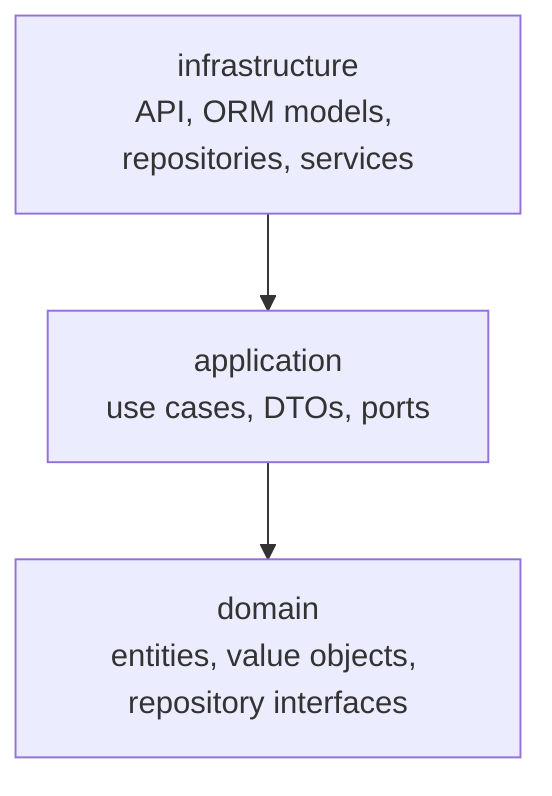
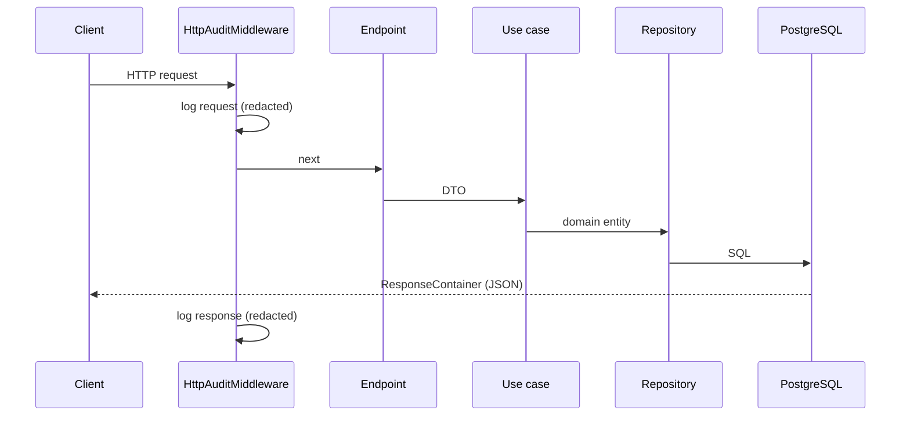

# Architecture

The service follows a layered (clean) architecture. Dependencies always
point inward - the domain knows nothing about the application layer, and the
application layer knows nothing about infrastructure.

## Layers



| Layer | Directory | Responsibility | What does not belong here |
|-------|-----------|----------------|---------------------------|
| Domain | `app/domain` | Entities, value objects, domain exceptions, repository interfaces | SQLAlchemy, FastAPI, HTTP |
| Application | `app/application` | Use cases, DTOs, ports (protocols) | Concrete technologies |
| Infrastructure | `app/infrastructure` | FastAPI endpoints, middleware, SQLAlchemy models and repositories, external services | Business rules |

## Package structure

```
app/
├── domain/
│   ├── shared/            # DomainError, ValidityPeriod,
│   │                      # validation functions + DomainValidationError, value objects
│   │                      # used across contexts (Address, CompanyId,
│   │                      # VatId, Iban)
│   └── <context>/
│       ├── entities/      # domain entities
│       ├── value_objects/ # immutable value types
│       ├── repositories/  # abstract repository interfaces (Protocol)
│       └── exceptions/    # domain exceptions
├── application/
│   ├── use_cases/         # one class per use case, single execute()
│   ├── dto/               # input/output contracts of use cases
│   ├── constants/         # code lists: document formats and templates/
│   │                      # (components/, variants/, labels/,
│   │                      # design/ - one file per entity)
│   ├── ports/             # TemplateEngine, DocumentRenderer, TimeProvider
│   └── exceptions/        # ApplicationError and its subclasses
└── infrastructure/
    ├── api/               # main.py, router.py, endpoints/, middleware/,
    │                      # schemas/, errors/, dependencies/
    ├── models/            # SQLAlchemy ORM models
    ├── repositories/      # repository implementations (Alchemy*)
    ├── services/          # template and renderer adapters, time
    ├── templates/         # document templates (static HTML files)
    ├── providers/         # clients of external services + HTTP audit
    ├── observability/     # redaction for the audit log
    ├── types/             # SQLAlchemy types for value objects
    ├── database/          # Base, engine, session
    ├── alembic/           # migrations
    ├── seed/              # default data, run after migrations
    └── config.py          # Settings
```

## Naming conventions

- A use case is a class with a single `execute()` method, named after a verb
  (`PrintInvoice`).
- DTOs mirror the domain objects: one file per entity (`dto/invoice/supplier.py`
  for `entities/supplier.py`) holding `<Entity>In` / `<Entity>Out`. A DTO that
  belongs to a use case only is named `<UseCase>In` / `<UseCase>Out`.
- ORM models are named `<Entity>Model` (e.g. `InternalRequestLogModel`).
- Repository implementations are named `Alchemy<Entity>Repository` and
  inherit from `BaseAlchemyRepository`.
- A domain entity never shares its name with an ORM model - mapping happens
  inside the repository.
- Repository methods follow a fixed contract: `get` always looks up by the
  entity's key, `delete` always takes that same key, and `save` always takes
  the domain entity itself (handles both insert and update).
- Any lookup that is not by that key gets a `_by_<field>` suffix (e.g.
  `get_by_name`), so a bare `get`/`delete` always means "by key".
- Entities never get their mutable fields set directly from outside -
  changes go through `create` (construction) and `update` (mutation), which
  enforce the entity's invariants. Shared validation lives in a private
  static/class `_validate` method called by both.
- Value objects are frozen dataclasses validated in `__post_init__`.
- `_validate` checks the values supplied by the caller of the service with
  the functions of `app/domain/shared/validation.py`
  (`validate_text(name=name, max_length=100)` - the keyword is the reported
  field); the first rejected value raises `DomainValidationError`.
- An entity never builds another entity or value object and does not check
  them. `create` gets them already built; putting them together is the job
  of the use case.
- Logic stays inline in use case `execute` methods and endpoint functions -
  no private helper methods there.
- Lines are wrapped at 80 characters.

## HTTP request flow



> Starlette runs middleware in reverse registration order. `HttpAuditMiddleware`
> is added last so it is the outermost one.

## Errors and responses

Every response is a `ResponseContainer` (`message_id`, `message`, `data`).

- Use cases raise subclasses of `ApplicationError`.
- `app/infrastructure/api/errors/` maps each of them to a
  (`MessageId`, HTTP status) pair; `main.py` registers one handler for all.
- Endpoints let these errors propagate, so `get_db` rolls the transaction
  back before the response is built.
- Anything else ends in the global fallback handler: Sentry +
  `SYSTEM_INTERNAL_FAIL` (500).

`MessageId` format: 2 digits main entity, 2 digits sub-entity, 3 digits
counter. `20xxxxx` (auth) and `90xxxxx` (system) are shared across all iZero
services and must keep the same values as the auth service.

## Observability

- Inbound calls: `HttpAuditMiddleware` -> `internal_request_log`,
  `internal_response_log`.
- Outbound calls: any `requests` call once `app.infrastructure.providers`
  is imported -> `external_request_log`, `external_response_log`.
- Sensitive headers and body fields are redacted (configurable in `.env`),
  unknown content types are never stored raw.
- Auditing never breaks the real call - DB errors in the audit are swallowed.
- Unhandled exceptions go to Sentry (`SENTRY_DSN`; empty disables it).
