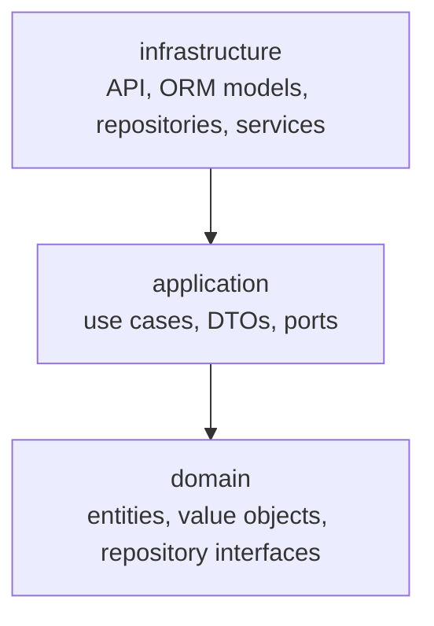

# Architecture

The service follows a layered (clean) architecture. Dependencies always
point inward - the domain knows nothing about the application layer, and the
application layer knows nothing about infrastructure.

## Layers



| Layer | Directory | Responsibility | What does not belong here |
|-------|-----------|----------------|---------------------------|
| Domain | `app/domain` | Entities, value objects, domain exceptions, repository interfaces | SQLAlchemy, FastAPI, HTTP |
| Application | `app/application` | Use cases, DTOs, ports (protocols) | Concrete technologies |
| Infrastructure | `app/infrastructure` | FastAPI endpoints, middleware, SQLAlchemy models and repositories, external services | Business rules |

## Package structure

```
app/
├── domain/
│   ├── shared/            # DomainError, ValidityPeriod,
│   │                      # validation functions + DomainValidationError, value objects
│   │                      # used across contexts (Address, CompanyId,
│   │                      # VatId, Iban)
│   └── <context>/
│       ├── entities/      # domain entities
│       ├── value_objects/ # immutable value types
│       ├── repositories/  # abstract repository interfaces (Protocol)
│       └── exceptions/    # domain exceptions
├── application/
│   ├── use_cases/         # one class per use case, single execute()
│   ├── dto/               # input/output contracts of use cases
│   ├── constants/         # code lists: document formats and templates/
│   │                      # (components/, variants/, labels/,
│   │                      # design/ - one file per entity)
│   ├── ports/             # TemplateEngine, DocumentRenderer, TimeProvider
│   └── exceptions/        # ApplicationError and its subclasses
└── infrastructure/
    ├── api/               # main.py, router.py, endpoints/, middleware/,
    │                      # schemas/, errors/, dependencies/
    ├── models/            # SQLAlchemy ORM models
    ├── repositories/      # repository implementations (Alchemy*)
    ├── services/          # template and renderer adapters, time
    ├── templates/         # document templates (static HTML files)
    ├── providers/         # clients of external services + HTTP audit
    ├── observability/     # redaction for the audit log
    ├── types/             # SQLAlchemy types for value objects, shape of
    │                      # the template dimensions files
    ├── database/          # Base, engine, session
    ├── alembic/           # migrations
    ├── seed/              # default data, run after migrations
    └── config.py          # Settings
```