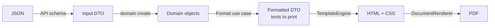

# Overview

The Print Module turns data into a printed document. The caller sends the
data of one document as JSON and gets back a PDF. The service stores
nothing, assigns no numbers and has no business logic of its own. Its
only job is to check that the data can be printed and to print it. The
first supported document is the invoice.

## The idea

Printing is split into four steps. Each step has one owner and knows
nothing about the steps after it:



| Step | Who | What it guarantees |
|------|-----|--------------------|
| Validate | API schema, then the domain entities and value objects | The data has the right shape and types (schema), and every value fits its place in the document (domain: lengths, required, no whitespace in the IBAN). The first invalid value stops printing (422). |
| Format | `Format<Document>` use case (`FormatInvoice`) | Every value is turned into the exact text that is printed: Czech numbers `1 234 567,50`, dates `2. 11. 2026`, IBAN in groups of four. Nothing is formatted later. |
| Fill | `TemplateEngine` port, Jinja adapter | The formatted texts are placed into the templates. Templates hold no logic and no texts of their own. |
| Render | `DocumentRenderer` port, Chromium adapter | The HTML is printed to PDF by headless Chromium (CSS paged media: paper, margins, page numbers). |

The `Print<Document>` use case (`PrintInvoice`) only puts the steps in
order. It chooses the design and the output format, so the API and the
adapters never decide what a document looks like.

## Documents are trees of components

A printed document is a tree of components with the same shape as the
domain entities:

```
DocumentComponent (variant = type of the document: page, header, footer)
└── InvoiceComponent (variant = layout of the invoice)
    ├── SupplierComponent ── AddressComponent
    ├── CustomerComponent ── AddressComponent
    ├── InvoiceItemComponent
    └── PaymentsComponent
```

Every component has:

- a **name** - which folder of templates prints it (`supplier/`),
- a **variant** - which of its looks is used (`supplier/plain.html.jinja`),
- **labels** - the fixed texts it prints (`IČO`, `Faktura`).

A **design** (`InvoiceDesign.CLASSIC`) is one combination of variants of
the whole tree. A new look of the invoice is a new design, not a new
template engine or a new use case.

The parent decides where its children are and how much space they get
(`<name>/<variant>.dimensions.json`); the child decides only how it looks
inside that space. The Jinja engine knows nothing about invoices: it only
finds `<name>/<variant>.html.jinja` for each component and gives it
`data`, `labels`, `dimensions`, `render(child, data)` and `style(child)`.

## Layers

| Layer | What lives there for printing |
|-------|-------------------------------|
| Domain (`app/domain`) | Entities and value objects of the document, every validation rule |
| Application (`app/application`) | Use cases (`Print*`, `Format*`), DTOs, ports, components, variants, labels, designs |
| Infrastructure (`app/infrastructure`) | API endpoint and schemas, error mapping, Jinja and Chromium adapters, the template files |

Dependencies point inward only. The general rules are in
[architecture.md](architecture.md) and
[naming-conventions.md](naming-conventions.md).

## Errors

- Invalid data: the domain raises `DomainValidationError`, the use case
  turns it into `InvalidDocumentDataError`, the API answers 422
  `PRINT_INVALID_DATA` with the problem (`code`, `field`, `message`).
  A body with a wrong shape is answered in the same format by the API.
- Anything else (broken template, missing Chromium): not caught anywhere,
  the global handler answers 500 `SYSTEM_INTERNAL_FAIL` and reports to
  Sentry.

See [errors-and-responses.md](errors-and-responses.md).

## Tests

| Folder | What it checks |
|--------|----------------|
| `tests/unit/domain` | Validation rules of the value objects; `invoice/` the entities of the invoice |
| `tests/unit/application/invoice` | Formatting, and the order of steps of the print use case (ports replaced by the in-memory fakes of `tests/support/`) |
| `tests/unit/infrastructure` | The real Chromium renderer, the dimensions of every design; `invoice/` the real Jinja engine with the invoice templates |
| `tests/e2e/invoice` | The HTTP contract: status codes, response bodies, headers |
| `tests/visual` | The printed PDFs look like their approved images |

Every test file holds its own data; only the fakes of the ports are
shared (`tests/support/`). Tests that print a real PDF need Chromium
installed and fail without it - they are never skipped.

## Where to go next

- Adding another document: [adding-a-document.md](adding-a-document.md)
- Design of the invoice in detail: the technical documentation in Notion
  (linked from the README)
