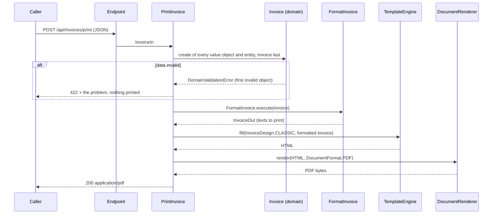

# Print Module - technical documentation

Technical design of the Print Module backend. It implements the
[Print Module - Analysis](https://app.notion.com/p/2fb2f764b0894ff186eb016a75db27d1)
(UC-1, BR-1 to BR-7, AC-1, AC-2). General rules of the service skeleton
are in [architecture.md](architecture.md).

## 1. What the service does

One operation: the caller sends invoice data, the service validates it,
fills the invoice template and returns a PDF. It has no business logic of
its own, assigns no numbers and stores no documents.



## 2. Layers

| Layer | Code | Responsibility |
|-------|------|----------------|
| Domain | `app/domain/invoices` (entities), `app/domain/shared/value_objects` (`Address`, `CompanyId`, `VatId`, `Iban`), `app/domain/shared/validation.py` | `Invoice` and its parts, value objects, every validation rule |
| Application | `constants/`, `use_cases/invoices/print_invoice.py`, `use_cases/invoices/format_invoice.py`, `ports/`, `dto/`, `exceptions/printing.py` | Order of steps of UC-1, ports of the template and the renderer, error contract |
| Infrastructure | `services/jinja_template_engine.py`, `services/weasyprint_document_renderer.py`, `templates/<name>/<variant>.html.jinja`, `api/` | Jinja2 template, WeasyPrint renderer, HTTP endpoint, error mapping |

Composition root: `api/dependencies/printing.py` creates the two adapters
(one instance each, both are stateless) and the endpoint passes them to the
use case. Tests replace them through FastAPI `dependency_overrides`.

## 3. Domain

```
Invoice
├── number, issue_date
├── supplier: Supplier ── name, company_id: CompanyId?, vat_id: VatId?, address: Address
├── customer: Customer ── name, company_id: CompanyId?, vat_id: VatId?, address: Address
├── items: InvoiceItem[1..n] ── description, quantity, unit?, unit_price, vat_rate?, total
└── payments: Payments ── iban: Iban, amount_to_pay, currency, variable_symbol?, due_date
```

The domain follows the conventions of [architecture.md](architecture.md):

- **Entities** (`Invoice`, `Supplier`, `Customer`, `InvoiceItem`,
  `Payments`) are built through `create`, which calls the private
  `_validate` and then the constructor. They have no `update` - a print
  request is never changed.
- **Value objects** (`Address`, `CompanyId`, `VatId`, `Iban`) are frozen
  dataclasses validated in `__post_init__`.
- An entity validates only the values supplied by the caller of the
  service. Its parts (value objects, other entities) are built by the use
  case (section 4) and taken as they are - the domain does not check its
  own application.

An existing `Invoice` is therefore always printable (BR-1).

### Validation rules

Data type, length and required follow section 5 of the analysis exactly.
Nothing else is checked: the module guarantees that every value fits its
place in the document, not that the value is correct. Correctness is the
caller's responsibility.

The data is checked where it enters:

| Where | What |
|-------|------|
| API request schema | Data type and required of every field (column Required of the analysis), at least one item |
| Domain | Length of every value; a required string must not be blank |

| Field | How the rule is applied |
|-------|-------------------------|
| Any string | Only the maximum length is checked; a required string that is blank is rejected as `required`; the value is printed as supplied |
| Decimal | Length = maximum number of digits, before and after the decimal point together (trailing zeros after the point and the sign do not count); the number of decimal places is not checked |

Not validated on purpose: the content of identifiers and codes (IBAN
check digits, company ID, VAT ID, currency, variable symbol; the country
is a free text),
arithmetic (item total, amount to pay) and the order of dates. See open
question 2.

### Reporting problems

Validation fails per object: `_validate` (entities) and `__post_init__`
(value objects) check the values with the functions of
`app/domain/shared/validation.py` and the first rejected value raises
`DomainValidationError`. Nothing is collected across the invoice - the
object that is invalid raises and the error goes straight to the use
case.

The checked value is passed to the function as a keyword argument, whose
name is the reported field - the name is never written twice:

```python
validate_text(description=description, max_length=200)
validate_decimal(quantity=quantity, max_digits=10)
```

The `ValidationProblem` of the error has:

- `code` - stable identifier: `required`, `too_long` (string too long or
  number with too many digits) from the domain; `invalid_type` and
  `invalid_format` only from the API for a malformed request
- `field` - name of the rejected field: `number`, `city`, `quantity`,
  `company_id`, `iban`
- `message` - English description for a developer; callers should rely on
  `code` + `field`

The entities are internal to the service, so the problem does not name
the entity that rejected the value - only the field. It therefore does
not say which item of the list or whose value (supplier's or customer's)
was rejected.

## 4. Use case UC-1 - `PrintInvoice`

Input `InvoiceIn`: the invoice data as supplied. Its structure is
complete - required values are always there (guaranteed by the API),
only the optional ones may be `None`. Output `PrintInvoiceOut`:
`content` (bytes), `document_format`, `invoice_number`.

| Step | Failure | Raised |
|------|---------|--------|
| 1. Build the domain objects from the DTO, from the inside out (value objects, `Supplier`, `Customer`, items, `Payments`, then `Invoice`). An optional value object that was not supplied is `None` | Data invalid | `InvalidDocumentDataError(problem)` - the next steps never run (BR-2) |
| 2. `FormatInvoice.execute` | - | Nothing of its own; see below |
| 3. `TemplateEngine.fill(InvoiceDesign.CLASSIC.value, DocumentOut(title, InvoiceOut))` | Any exception | `TemplateFillingError` (BR-6) |
| 4. `DocumentRenderer.render` | Any exception | `DocumentRenderingError` (BR-6) |

### DTOs

The DTOs mirror the domain objects, one file per object, each with the
supplied (`In`) and the formatted (`Out`) form:

| Domain | DTO file | DTOs |
|--------|----------|------|
| `invoices/entities/invoice.py` | `dto/invoice/invoice.py` | `InvoiceIn`, `InvoiceOut` |
| `invoices/entities/supplier.py` | `dto/invoice/supplier.py` | `SupplierIn`, `SupplierOut` |
| `invoices/entities/customer.py` | `dto/invoice/customer.py` | `CustomerIn`, `CustomerOut` |
| `invoices/entities/invoice_item.py` | `dto/invoice/invoice_item.py` | `InvoiceItemIn`, `InvoiceItemOut` |
| `invoices/entities/payments.py` | `dto/invoice/payments.py` | `PaymentsIn`, `PaymentsOut` |
| `shared/value_objects/address.py` | `dto/shared/address.py` | `AddressIn`, `AddressOut` |

`CompanyId`, `VatId` and `Iban` are plain strings in the DTOs.
`dto/invoice/print_invoice.py` holds `PrintInvoiceOut`, the result of the
use case.

### Constants

Code lists of the application layer in `app/application/constants/`:

| File | Content |
|------|---------|
| `document_formats.py` | `DocumentFormat` - formats a document can be printed in (`PDF`); the use case chooses it, the renderer only implements it and the endpoint turns it into `Content-Type` and the file extension |
| `templates/components/<entity>.py` | One component class per entity, see below |
| `templates/variants/<entity>.py` | Visual variants of each entity: `DocumentVariant` (page styles), `HeaderVariant`, `FooterVariant`, `InvoiceVariant` (layouts), `SupplierVariant`, `CustomerVariant`, `AddressVariant`, `InvoiceItemVariant`, `PaymentsVariant` |
| `templates/labels/<entity>.py` | Texts printed with each entity: `FooterLabel`, `InvoiceLabel`, `SupplierLabel`, `CustomerLabel`, `InvoiceItemLabel`, `PaymentsLabel` (`TITLE = "Faktura"`, `COMPANY_ID = "IČO"`, ...) |
| `templates/design/invoice.py` | `InvoiceDesign` - the designs of the invoice |

#### Templates

The components form a tree with the same shape as the entities. A parent
holds its children as attributes, so the tree itself
says what is a parent and what are its children:

```python
class InvoiceDesign(Enum):
    CLASSIC = DocumentComponent(
        variant=DocumentVariant.STANDARD,           # type: page, header, footer
        content=InvoiceComponent(
            variant=InvoiceVariant.CLASSIC,         # layout of the invoice
            supplier=SupplierComponent(
                variant=SupplierVariant.PLAIN,
                address=AddressComponent(variant=AddressVariant.LINES),
            ),
            customer=CustomerComponent(
                variant=CustomerVariant.PLAIN,
                address=AddressComponent(variant=AddressVariant.LINES),
            ),
            items=InvoiceItemComponent(variant=InvoiceItemVariant.ROW),
            payments=PaymentsComponent(variant=PaymentsVariant.TABLE),
        ),
    )
```

| Entity | Component | Children |
|--------|----------------|----------|
| - | `DocumentComponent` | `content`; `header`, `footer` fixed by its variant |
| - | `HeaderComponent` | - |
| - | `FooterComponent` | - |
| `Invoice` | `InvoiceComponent` | `supplier`, `customer`, `items`, `payments` |
| `Supplier` | `SupplierComponent` | `address` |
| `Customer` | `CustomerComponent` | `address` |
| `InvoiceItem` | `InvoiceItemComponent` | - |
| `Payments` | `PaymentsComponent` | - |
| `Address` | `AddressComponent` | - |

Every component has a `name` (what is printed), a `variant` (which
visual form) and `labels`. A design is one combination of variants: the
variant of the invoice is the layout placing the children on the paper,
the variant of a child is how the child looks. Adding a design means
adding a member to `InvoiceDesign`, the members of the new variants to
their enums in `variants/` and the files of those variants. A variant is
an enum member, never a free string, so a design cannot name a variant
that does not exist.

`DocumentComponent` is the parent of every printed document. It has no
entity in the domain - it exists only for printing. Its variant is the
type of the document: its page style (paper, margins, fonts,
background) and its header and footer. The header and the footer are
components of their own (own folder, variants, labels and templates),
but a design never chooses them - they are bound to the type of the
document in `DocumentComponent.HEADERS` and `.FOOTERS`, and the design
chooses only the type and the content. The concrete values
(millimetres, font names, colours) are in the template files. The document gets its own data,
`DocumentOut` (`title`, `content`), built by the use case.

`PrintInvoice` always uses `InvoiceDesign.CLASSIC` - choosing a design by
the caller is out of scope of the analysis.

### Use case `FormatInvoice`

Turns a validated `Invoice` into `InvoiceOut` - the same structure
with every value as the text that is printed (optional values that were
not supplied stay `None`). It only formats: nothing is validated and the
invoice is expected to be valid.

| Value | Format |
|-------|--------|
| Money (unit price, total, amount to pay) | `1 234 567,50` - two decimal places, thousands separated by a non-breaking space |
| Quantity, VAT rate | `2,5` - as supplied, without trailing zeros |
| Dates | `2. 11. 2026` |
| IBAN | Groups of four, whatever grouping it was supplied in: `CZ65 0800 0000 1920 0014 5399` |
| Everything else | Unchanged |

### Ports

| Port | Contract | Adapter |
|------|----------|---------|
| `TemplateEngine.fill(component, data) -> str` | Fills the template of the component (a node of the tree: `name`, `variant`, `labels`) with the formatted data; the template places its own values and its children, each child filled the same way with its part of the data. Does no formatting and holds no text of its own. Any exception = filling failed. | `JinjaTemplateEngine` |
| `DocumentRenderer.render(document, document_format) -> bytes` | Returns the content of the printed document in the format the use case asks for. Any exception = rendering failed. | `WeasyPrintDocumentRenderer` |

The use case, not the adapters, turns port failures into application
errors, so an adapter cannot leak a raw library exception by mistake.

## 5. Template and renderer

**Template files** - in the directory set by `TEMPLATES_DIR` in `.env`
(default `app/infrastructure/templates`), one folder per entity and one
file per variant:

```
templates/
├── document/       standard.html.jinja, .css.jinja <- <html>, page: paper, margins, fonts, background
│                   (+ .dimensions.json next to every variant)
├── footer/         page_numbers.css.jinja <- footer of every page
├── invoice/        classic.html.jinja, .css.jinja <- layout: areas on the paper + children
├── supplier/       plain.html.jinja, plain.css.jinja
├── customer/       plain.html.jinja, plain.css.jinja
├── address/        lines.html.jinja
├── invoice_item/   row.html.jinja, row.css.jinja
└── payments/       table.html.jinja, table.css.jinja
```

The Jinja engine knows nothing about invoices, only two rules:

1. The template of a component is the file `<name>/<variant>.html.jinja`, with
   optional styles in `<name>/<variant>.css.jinja` and its dimensions in
   `<name>/<variant>.dimensions.json`.
2. Inside a file there is `component` (the node, its children are its
   attributes), `data`, `labels`, `dimensions`, `render(child,
   child_data)` and `style(child, child_data)`.

The header and the footer are printed in the page margins (CSS `@page`
margin boxes), so their templates are stylesheets only. The header
variant `none` has no file at all and prints nothing.

The files are named `.html.jinja` and `.css.jinja`, not `.html` and
`.css`: they hold Jinja expressions, which an editor would report as
errors in a plain HTML or CSS file.

The parent says which children it has and where they have their place;
the child fills only its own content:

```html
<!-- invoice/classic.html.jinja -->
<section class="area-supplier">
  {{ render(component.supplier, data.supplier) }}
</section>

<!-- supplier/plain.html.jinja -->
<div class="name">{{ data.name }}</div>
{{ render(component.address, data.address) }}
```

The areas (`.area-*`) and their sizes are defined only in the layout of
the parent. Styles of a child are in its `.css.jinja` file and the parent puts
them into the document with `style(...)`. No file has filters, formats
anything or holds a text of its own (`{{ labels.TITLE }}`). Optional values (unit, VAT rate, VAT IDs, company IDs,
variable symbol) are left out when not supplied. The item table repeats
its header on every page and never splits a row; the footer carries the
invoice number and `Strana X z Y`.

- `autoescape` is on - supplied data cannot inject markup.
- `StrictUndefined` - a place in the template without data is an error
  (`TemplateFillingError`), never a silently empty spot.

### Dimensions

The parent decides where a child is and how wide its place is; the child
decides how it looks and how high it is. Both sides write their numbers
into `<name>/<variant>.dimensions.json`:

| Key | Who | Meaning |
|-----|-----|---------|
| `needs.min_width_mm` | child | Width the component needs at least |
| `needs.max_height_mm` | child | The most the component can be high; missing = it flows over pages (invoice, items) |
| `slots.<child>.width_mm`, `.height_mm` | parent | Place given to the child; height is optional |
| `rows` | parent | The slots from top to bottom; slots of one row are side by side |
| `gap_mm` | parent | Space between the slots of one row |
| `page` | document | Paper and its margins |

```json
// invoice/classic.dimensions.json
{
  "needs": { "min_width_mm": 178 },
  "slots": {
    "supplier": { "width_mm": 84 },
    "customer": { "width_mm": 84 },
    "items":    { "width_mm": 178 },
    "payments": { "width_mm": 178 }
  },
  "rows": [["supplier", "customer"], ["items"], ["payments"]],
  "gap_mm": 10
}
```

The shape of the file is described by `Dimensions` (with `Needs`,
`Slot` and `Page`) in `app/infrastructure/types/template_dimensions.py`.

The numbers are written once: the styles take the page size, the margins,
the widths of the slots and the gap from `dimensions`
(`width: {{ dimensions.slots["supplier"].width_mm }}mm`). In a template
a slot is read with brackets, because `slots.items` would be the method of
the dictionary.

`tests/unit/infrastructure/test_component_dimensions.py` walks the tree of
every design and checks, without rendering:

- a row is not wider than what the parent has,
- every child gets at least the width it needs,
- a child with a maximum height fits the height of its slot, or one page,
- the children fit the maximum height of their parent,
- the content of the document gets exactly the page without the margins.

Not checked yet: that the text of the longest allowed values really fits
the declared `max_height_mm`. That needs rendering the worst case with
WeasyPrint and measuring the result; until then the maximum heights are
estimates.

**Renderer** - WeasyPrint (HTML + CSS paged media -> PDF, A4).

- It is forbidden to fetch any URL while rendering
  (`URLFetcher(allowed_protocols=())`).
- WeasyPrint needs the native Pango libraries. The Docker image installs
  them together with the DejaVu fonts. Where they are missing (plain
  Windows) the service still starts and printing ends with
  `PRINT_RENDERING_FAILED`; tests that need a real PDF are skipped.

## 6. API

`POST /api/invoices/print`, body `application/json`:

```json
{
  "number": "2026-0042",
  "issue_date": "2026-11-02",
  "supplier": {
    "name": "Dodavatel s.r.o.",
    "company_id": "12345678",
    "vat_id": "CZ12345678",
    "address": {
      "street": "Dlouhá 12",
      "city": "Praha",
      "postal_code": "110 00",
      "country": "Česká republika"
    }
  },
  "customer": {
    "name": "Odběratel a.s.",
    "address": {
      "street": "Krátká 3",
      "city": "Brno",
      "postal_code": "602 00",
      "country": "Česká republika"
    }
  },
  "items": [
    {
      "description": "Konzultace",
      "quantity": "2.5",
      "unit": "h",
      "unit_price": "1200.00",
      "vat_rate": "21",
      "total": "3630.00"
    }
  ],
  "payments": {
    "iban": "CZ65 0800 0000 1920 0014 5399",
    "amount_to_pay": "3630.00",
    "currency": "CZK",
    "variable_symbol": "20260042",
    "due_date": "2026-11-16"
  }
}
```

Decimals may be sent as JSON strings (recommended, exact) or numbers;
dates as `YYYY-MM-DD`. Unknown fields are ignored.

| Outcome | Status | Body |
|---------|--------|------|
| Printed | 200 | The PDF, `Content-Type: application/pdf`, `Content-Disposition: inline; filename="invoice-<number>.pdf"` |
| Invalid data | 422 | `ResponseContainer`, `message_id` `PRINT_INVALID_DATA` (3000001), `data` = list with one `{code, field, message}` |
| Template filling failed | 500 | `ResponseContainer`, `PRINT_TEMPLATE_FILLING_FAILED` (3000002) |
| Rendering failed | 500 | `ResponseContainer`, `PRINT_RENDERING_FAILED` (3000003) |
| Anything unexpected | 500 | `ResponseContainer`, `SYSTEM_INTERNAL_FAIL` (9000001) |

All 5xx responses are reported to Sentry.

The pydantic request schema gives the body its shape and data types and
requires the parts of the invoice (supplier, customer, both addresses,
payments, at least one item) and every value the analysis marks as
required.
A body that is not JSON, misses a part or holds a value of a wrong type
(FastAPI `RequestValidationError`) is answered in the same 422 format
(`invalid_format` / `required` / `invalid_type`, `field` is the path in
the body, e.g. `supplier.address`), so the caller handles one format.
Such problems are reported before the domain rules run and may be
several.

**Access (BR-7).** The service has no authentication or authorization. It
must be deployed without a public route - reachable only from the internal
network of the iZero services. This is a deployment requirement on
iZero-infra, nothing in the code enforces it.

## 7. Persistence

| What | Decision |
|------|----------|
| Printed documents, print history | Not applicable - nothing is stored (BR-3) |
| Templates | Static files in the service image; no table, repository or seed |
| HTTP audit log | Kept from the service skeleton: `internal_request_log` / `internal_response_log` (migration `0001_initial`). The PDF itself is never stored (unknown content types are replaced by a placeholder). See open question 3. |

PostgreSQL is therefore still required, only for the audit log.

## 8. Requirement to test mapping

| Requirement | Test |
|-------------|------|
| BR-1, section 5 (every field rule) | `tests/unit/domain/test_invoice.py`, `test_value_objects.py` |
| BR-2, AC-1 (problem returned, nothing printed) | `test_invoice.py::test_entity_rejects_invalid_value`, `tests/unit/application/test_print_invoice.py::test_invalid_data_...`, `tests/api/test_print_invoice.py::test_invalid_data_...` |
| BR-4 (template filled with the data) | `tests/unit/application/test_format_invoice.py`, `tests/unit/infrastructure/test_jinja_template_engine.py` |
| BR-5, AC-2 (PDF returned) | `test_weasyprint_document_renderer.py`, `tests/api/...::test_valid_invoice_is_returned_as_pdf`, `::test_end_to_end_with_the_real_renderer` |
| BR-6 (print error) | `tests/unit/application/...::test_template_failure_...`, `::test_rendering_failure_...`, `tests/api/...::test_template_failure_...`, `::test_rendering_failure_...` |
| BR-3, BR-7 | No code - see sections 6 and 7 |

Run with `pytest`. Ports are replaced by the in-memory fakes in
`tests/support.py`; no test needs a database.

## 9. Open questions

1. **All problems or the first one?** BR-2 says all validation problems
   are returned; UC-1 and AC-1 say "first validation problems".
   Decided: the first one - the invalid entity raises and nothing is
   collected. BR-2 in the analysis should be reworded.
2. **Consistency rules.** The analysis asks for a consistency check but
   lists no rule. Should the module verify `total = quantity x unit_price`
   (with or without VAT?), `amount_to_pay = sum of totals` and
   `due_date >= issue_date`? Not implemented - they are business rules of
   the caller and the answers are not obvious (rounding, advances, credit
   notes).
3. **Audit log vs. "stores nothing".** The skeleton's audit middleware
   stores the request body - i.e. the invoice data - in
   `internal_request_log` (truncated to `HTTP_AUDIT_MAX_BODY_LENGTH`).
   Decide whether that is acceptable, or whether bodies should be
   excluded for this service (which would also allow dropping PostgreSQL).
4. **Field lengths** in section 5 of the analysis are marked as a draft.
   They are written once, in `_validate` of the entities and at the value
   objects.
5. **Template language and content.** Czech labels were chosen (IČO, DIČ,
   variable symbol; kept in `constants/templates/labels/`); the analysis does not prescribe the language, nor
   legally required texts (e.g. date of taxable supply, VAT recap).
6. **`MessageId` range.** `30xxxxx` was taken for printing because it is
   unused in iZero-backend; confirm the numbering.
